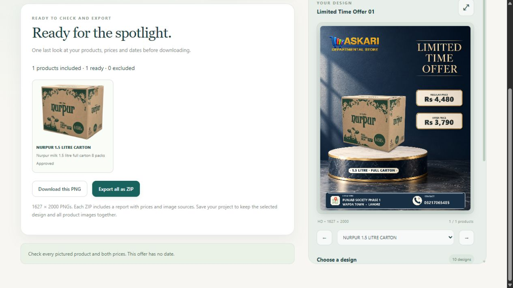
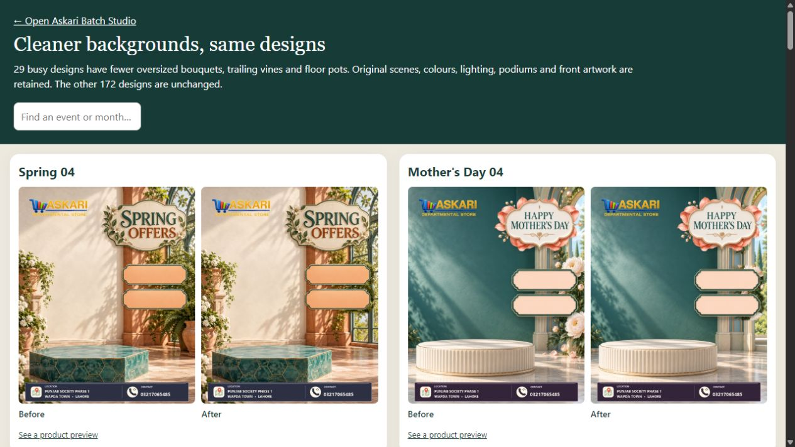
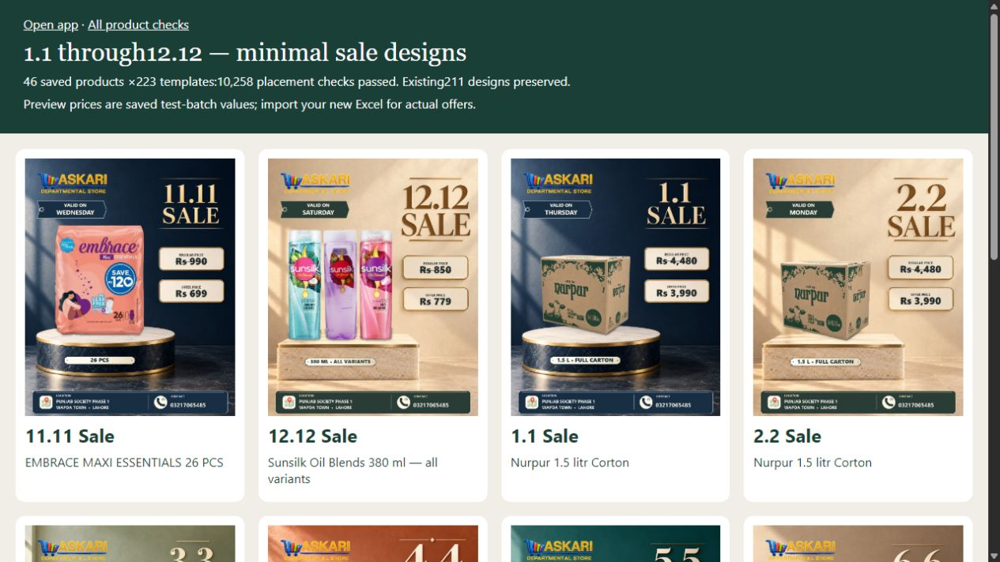

# Askari Batch Studio — Retail Promo Poster Automation

> Turns a spreadsheet of products and prices into a full batch of branded, print-ready promotional posters in minutes. Built for **Askari Departmental Store, Lahore** to replace hours of manual Canva work each week.



## What it does
- **Excel / CSV import** – paste or upload product rows (name, normal price, sale price, weight); the spreadsheet is the single source of truth for prices.
- **211 saved campaign templates** – monthly offers, Ramadan, Eid, 14 August, Sunday Special, Weekend and Limited Time Offer designs, with automatic price-tag styles.
- **Automatic product photos** – checks a local product library first, then searches online stores by product name and verifies brand, pack size and variant before use.
- **AI background removal** – bundled U²-Net (ONNX Runtime, CPU-only) cuts products out cleanly while keeping original pixels.
- **Smart validity badges** – one date shows the weekday ("VALID ON SUNDAY"), a range shows the full offer period, "no date" mode hides the badge.
- **Batch export** – one PNG or the whole batch as a ZIP at 1627×2000, plus saved projects you can reopen.

| Background cleanup | Product review |
|---|---|
|  |  |

## Tech stack
**Python** (standard-library HTTP server, threading, Pillow, NumPy, ONNX Runtime) · **JavaScript** (canvas layout engine, cropping, ZIP export) · HTML/CSS

## Architecture
```
index.html + app.js / layout.js / crop.js / validity.js   →  browser UI & canvas rendering
server.py   (127.0.0.1 only, host-header checked)        →  JSON actions: lookup, fetch, isolate, remember
pictures.py / identity.py / groups.py / library.py        →  product search, pack-size & brand matching
matting.py                                                 →  U²-Net background removal
```

## Run locally
```bash
pip install -r requirements.txt
# place u2netp.onnx in ./models
python server.py
```
On Windows, `Start Askari Studio.cmd` launches it with a bundled runtime.

---
Built by **Muhammad Uzair** · [Portfolio](https://uzzicodes.github.io) · [LinkedIn](https://www.linkedin.com/in/uzzicodes/)
